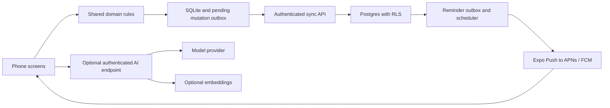

# Personal memory and routine assistant — implementation plan

Status: architecture baseline. The first local-only mobile increment is implemented; see README.md and validation.md for actual delivered scope. Backend, sync and notification phases remain unimplemented. This document separates intended verification from checks actually performed. Working name: Pocket Memory.

## 1. Product outcome and assumptions

Capture an idea before it is forgotten, remember a recurring responsibility, and record progress toward a personal goal in seconds. The same app provides a searchable history and dashboard. Start with one personal account, but isolate all account data from the beginning.

Default assumptions: iOS and Android support; text input first; a local-first phone app with optional cloud intelligence; English initially; Monday–Sunday weeks; device timezone suggested during onboarding and explicitly saved as an IANA timezone. The client timezone currently suggests America/Los_Angeles, which the user can change. No external calendar connection is assumed. Events entered in the app have calendar-like reminders. No paid subscriptions or production infrastructure will be purchased as part of planning.

Primary screens: Today, Capture, Ideas, Dashboard, Search, and Settings. Today includes an inbox count, pending chores, upcoming events and habit progress. Dashboard covers activity frequency, weekly goal completion, pending/overdue counts, ideas by status/tag, and recent activity. Every chart opens its underlying records. Missing logs mean “not logged,” not proof an activity did not happen. Avoid shame-oriented streaks.

## 2. Required behaviors

| Input/action | Expected result |
| --- | --- |
| “Explore a meal-planning app” | Save an idea immediately; optionally add tags; no fabricated deadline. |
| “Take trash out every Thursday night” | Preview a weekly Thursday 7 p.m. chore in the saved timezone; user may adjust; each week has its own completion. |
| “Did a run today” | Preview an activity log dated today in the user's timezone, then count it toward the current weekly running goal. |
| “Run at least once a week” | Create a goal with target 1; Friday 6 p.m. reminder if unmet and Sunday 10 a.m. follow-up if still unmet. |
| Log a run after a reminder was planned | Recompute progress and suppress unsent reminders for that goal period. |
| Enter an event at a precise time | Plan reminders 24 hours and 1 hour before; omit past offsets. |
| Search “ideas about food” | Return matching ideas with source text and tags, plus optional semantic matches if enabled. |

Capture always saves raw text locally first. Classification produces an editable card, never an invisible write. Explicit structured quick actions (Log run, Add idea, Complete trash) skip unnecessary confirmation and provide Undo. Ambiguous dates/types stay in the inbox with suggested fields. “Next Thursday” is displayed as an actual date before confirmation. Multi-intent messages can produce several proposed cards; users approve them together or separately. An idea is never silently promoted to a commitment.

Chores support complete, snooze and skip this occurrence. Completing late applies to the selected occurrence, not every overdue week. Habits support dated logs, correction and deletion, targets above one, and history. User can mark an idea explored, archive it, or convert it to a task while preserving its origin.

Quiet hours default to 9 p.m.–8 a.m.; general and habit prompts defer to the next allowed time. For an event reminder that would move past its event, omit it and show the suppression in reminder history. An explicit user-selected reminder time may override quiet hours only after the user opts in. Idea review defaults to Sunday 4 p.m., at most three active ideas, rotating least-recently-shown items; no alert when there are none. Permit disabling every category and changing all default times. Cap routine/review nudges at two per day and coalesce excess into a summary; explicitly scheduled event/task reminders are separate.

## 3. Technical decisions

Use TypeScript throughout application and shared domain code. Mobile: Expo + React Native + Expo Router; SQLite through expo-sqlite; SecureStore for auth tokens; TanStack Query for remote cache; Zod for validating API and AI outputs; React Hook Form for editable forms. Use the current stable, mutually compatible Expo SDK and Node LTS at implementation kickoff and pin exact dependencies with a committed lockfile. Avoid choosing unverified version numbers in this plan.

Backend: Supabase hosted PostgreSQL, Auth and Row Level Security; SQL migrations in the repository; Edge Functions for authenticated capture/search/sync endpoints and push dispatch; pg_cron plus a database outbox for periodic scheduling. Use PostgreSQL full-text search and indexed filters first. Add pgvector only after the semantic-search evaluation gate passes. Local backend uses Supabase CLI and Docker. Shared pure TypeScript modules own date/goal rules; use a maintained IANA timezone library rather than fixed UTC offsets.

Testing: Vitest for pure domain logic, SQL integration tests for RLS/sync/scheduling, React Native Testing Library for client interactions, and Maestro for physical-device/simulator flows. GitHub Actions runs type checking, linting, unit and database integration tests. A web dashboard may be added later; the initial dashboard lives inside the mobile app.

Why a native app: Expo produces a real installable iOS/Android application and supports local scheduled notifications and push. A PWA is faster to distribute, but installation and background behavior vary, particularly on iOS, making it a weaker default for a reminder-centered product. Expo Go is only an early UI playground; notification readiness requires an Expo development build on physical devices. Distribution starts with internal Android builds and iOS TestFlight when accounts/signing are available. Store release is a later step.

## 4. Architecture and ownership

The phone owns unsynced input and cached reads. PostgreSQL owns accepted revisions, reminder decisions and synced aggregate history. Use pg_cron with a supported HTTPS invocation mechanism to call the worker; keep its credential in backend secret storage and verify scheduler authentication in the Edge Function before privileged access. Do not embed the secret in a committed migration or expose the worker anonymously. No server code or AI provider key lives in the app. AI is a suggestion engine; deterministic code owns recurrence, completion counts, date arithmetic and notification eligibility. No microservices or separate message broker in version one.

Suggested layout: apps/mobile; packages/domain; packages/contracts; supabase/migrations; supabase/functions; tests/integration; docs. Keep business rules framework-independent. Use migrations and seed fixtures, never dashboard-only schema edits. Production uses separate credentials and projects from local/dev.

## 5. Data model

Every account-owned row carries user_id, UUID id, created_at, updated_at, integer revision and nullable deleted_at. Server timestamps and revisions govern sync; local clock timestamps are informational. All quantities have explicit units.

| Entity | Important fields/invariants |
| --- | --- |
| captures | raw_text, client_created_at, classification_status; preserve original wording |
| ideas | capture_id, title, body, status, tags, last_reviewed_at |
| tasks | title, due_at or due_local_date, status, source_idea_id; all-day dates remain dates |
| recurring_tasks | title, frequency, interval, weekday, wall_time, timezone, enabled |
| task_occurrences | recurring_task_id, local_date, due_at, state, completed_at; unique series/date |
| events | title, starts_at, timezone, local fields for editing; no external calendar sync yet |
| habits | activity_type, target_count, weekly period, timezone, reminder preferences |
| activity_logs | activity_type, occurred_at, occurred_local_date, timezone, optional metrics, capture_id |
| settings | timezone, quiet hours, category preferences, review schedule |
| devices | token, platform, last_seen_at, enabled; revoke expired tokens |
| notification_jobs | occurrence/goal-period id, scheduled_at, state, lease_until, attempt_count, rule_revision, unique dedupe_key |
| notification_attempts | job_id, provider_ticket, receipt outcome, timestamps; minimal payload |
| change_log / mutation_receipts | monotonic server cursor; unique user/client_mutation_id |

Use normalized joins for tags if filtering needs them. Derived habit progress is computed from nondeleted logs; do not maintain a client-editable “runs completed” counter. Persist a habit attribution date and timezone for every log, using the habit timezone setting effective at the activity instant; reminders and dashboard use this same date, never the traveling device date. Preserve the originally reported timezone/date separately. Date-only entries preview the date in the habit timezone. Habit timezone policies are effective-dated, and existing attribution never changes implicitly. Changing home timezone affects future reminders; changing historical log dates is explicit. Editing/deleting logs recomputes progress and future eligibility. Tombstones must survive long enough for all active clients to receive them; expired clients do a full resync before uploading new work.

## 6. Offline and synchronization

First launch requires authentication/network for cloud sync; a local-only mode remains useful without cloud or AI. Offline capture, browse, structured search, completion and run logging must work after initial setup. SQLite transaction writes the entity and a UUID-keyed pending mutation together. Repeated taps and retries carry the same mutation ID. Server transaction validates ownership and expected revision, writes the change and receipt, then returns the canonical row and cursor. Pull changes using a server-issued monotonic cursor; never a phone timestamp.

Append-only activity logs merge naturally; correction/deletion requires expected revision. Concurrent edits return a conflict with both versions for user resolution, preserving raw capture; do not silently overwrite. Recurring-task changes invalidate future pending jobs using a rule revision. Allocate feed cursors under a per-user database row lock held through the mutation transaction commit; every write path must participate. An unconstrained PostgreSQL sequence is insufficient because transactions can commit out of order. Pull a snapshot and high-water cursor in one consistent database snapshot. Test a delayed transaction racing another write to prove no committed record is missed. A cursor is advanced only after all pulled rows are committed locally. Expired cursor triggers snapshot plus cursor recovery without losing pending local mutations. Switching accounts clears account-scoped cache and cancels its local notifications. Local-only to account migration uses the same idempotent UUID mutation protocol and an explicit preview.

## 7. Reminder execution and reliability

For a synced account, server push is the sole routine reminder authority in v1. New offline reminders show “pending sync”; they cannot alert through the server until uploaded. One primary notification device receives alerts initially; additional signed-in devices can capture and browse. Switching the primary device revokes the former notification destination. A scheduler runs at least once per minute, creates jobs within a rolling horizon (e.g. 14 days), and claims due jobs atomically with leases. Immediately before dispatch it checks current completion, preferences, quiet hours and rule revision. Stable dedupe keys combine user, occurrence/goal period, reminder kind and revision. Retry transient failures with capped exponential backoff; poll provider receipts, retire invalid tokens and expire stale jobs. On deployment/restart recover expired leases. Old routine reminders collapse into one still-relevant summary; old event reminders expire after the event begins. Notification taps always load current state before offering actions; they never complete an item solely from stale payload data.

Push is best effort: OS focus modes, denied permission, battery policy, connectivity and provider delays prevent exact delivery guarantees. Distinguish planned, provider-accepted and receipt outcomes; a receipt does not prove the user saw an alert. A crash after provider acceptance can produce a duplicate despite database dedupe; record attempts and use collapse identifiers where supported. Never claim exactly-once delivery. Completion on another offline device cannot suppress a server reminder until synced; show “saved on this device—reminder cancellation pending sync.”

Local-only mode uses local OS notifications with the same rule engine and a bounded scheduled horizon, refreshed when the app opens. Show the scheduled-through date and the limitation that reminders may stop beyond that horizon without reopening. Do not run local and server alerts for the same occurrence. Switching modes requires canceling known local IDs before enabling cloud scheduling, with a test for transition failures. Consider offline fallback for cloud users only in a later release because ownership handoff is complex.

DST policy: recurring chores preserve their saved wall-clock time; nonexistent times move forward to the first valid time, repeated times use the first occurrence, producing one reminder. Weekly period boundaries are local Monday midnight to next Monday midnight; no fixed 168-hour assumption. Events use absolute instants and their display timezone. Follow-up habit prompts are canceled once the period goal is met; undoing a log can restore only future eligible prompts, never replay old ones.

## 8. Intelligence, search and dashboard

Stage 1 works without a model: explicit capture types, templates, simple suggested parsing, full-text search across titles/body/raw captures, tags and date/status/type filters. A phrase such as “did a run today” can use a tested deterministic pattern. Search is account-scoped both locally and on the server. Dashboard uses indexed SQL aggregates; week selection, chart totals and drill-down lists share the same date-boundary rules.

Stage 2 optionally sends only the submitted capture to an AI endpoint, validates a strict schema and returns a preview with confidence/ambiguities. Model failure or no key keeps the capture safe and editable. No tool execution based on captured text. Users explicitly enable AI processing; explain provider retention and transmitted fields before activation. Sanitize logs and avoid recording personal text in telemetry. Model choice is configurable server-side with per-user rate limits and spend caps.

Stage 3 hybrid semantic search combines ranked lexical matches with per-record embeddings; enforce user filtering inside the database query before ranking and constrain returned columns. Embeddings are treated as personal data, deleted/recomputed with their source. Offline search stays lexical. Answers such as “What ideas did I have about food?” show linked source records and never invent missing activities. Ship semantic search only if a curated query set demonstrates an improvement over lexical search. No RAG framework required initially.

Dashboard v1: weekly running count against goal; last run; chores due/overdue; upcoming events; active and recently revisited ideas; activity calendar; recent timeline. Filters by time range/type/tag apply consistently. Later intelligence can suggest a preferred reminder time from actual completion patterns, but never change schedules without a visible proposed change and user acceptance.

## 9. Privacy, access and operations

Supabase Auth with email OTP/magic link and mobile deep-link handling. RLS denies cross-user reads/writes for every table and vector/aggregate RPC; derive user identity from verified JWT, never request bodies. Service-role credentials remain server-only and scoped endpoints validate the caller. Push previews default to generic text with an opt-in for detailed content. SecureStore protects tokens; SQLite is app-private but is not assumed encrypted. Optional app lock/encrypted database is a later decision if storing sensitive records becomes a priority.

Offer JSON export, account deletion and local-data erasure. Account deletion removes embeddings, tokens and jobs as well as content. Define and display backup retention separately; hosted backups may age out rather than disappear immediately. Back up hosted data and perform a restore rehearsal before relying on it. Monitor scheduler heartbeat, queue age, sync failures and push rejection rates without capturing content. Local-only data needs an explicit export/backup reminder; uninstall may erase it.

## 10. Local development and phone installation

The cloud environment can build shared code and run tests; it cannot prove physical iOS/Android notification delivery. Use the existing checkout in cloud tasks; do not create worktrees unless requested.

At implementation kickoff create and verify the scripts below; they are planned commands, not commands currently present in this empty repository. Prerequisites: Git, pinned Node LTS, pnpm via Corepack (or verified standalone installation), Docker Desktop for local Supabase, Supabase CLI; Xcode on macOS for iOS simulator builds; Android Studio/JDK version supported by the chosen Expo SDK for Android. Windows/Linux can develop Android; iOS builds need macOS or a hosted build service and Apple signing.

1. Clone agent-test to the laptop, install the pinned Node/pnpm versions, run `pnpm install --frozen-lockfile`.
2. Run `pnpm backend:start` (Supabase local), `pnpm db:reset` (local development database only; refuses hosted targets), and `pnpm db:seed` with synthetic personal data.
3. Copy `.env.example` to an ignored `.env.local` containing only client-safe backend URL and publishable key. Server AI keys live in ignored server configuration or hosted secrets. Never put service-role keys in EXPO_PUBLIC variables.
4. Run `pnpm dev:mobile`. For native modules/notifications use `pnpm mobile:android` or `pnpm mobile:ios` to create a development build. Document exact simulator/device destinations once tested.
5. A physical phone cannot reach laptop localhost. For local backend access use the laptop's LAN address on trusted Wi-Fi and configure the API advertised address. A Metro tunnel exposes the bundler, not automatically the backend. For push/auth testing prefer a separate hosted development Supabase project with HTTPS and verified deep-link callback URLs.
6. For installable builds configure EAS profiles: development, internal preview and production. Configure APNs/FCM credentials using secure build tooling; Apple/Google accounts and fees may be required. Android internal APK installs directly; iOS physical installation requires Apple-supported signing/provisioning, typically TestFlight or registered-device builds. EAS is optional; local native builds remain supported.
7. Run local checks `pnpm lint`, `pnpm typecheck`, `pnpm test`, `pnpm test:integration`; run documented Maestro scenarios against a development build. Keep simulator UI evidence separate from physical push evidence.

Hosted operation requires an always-on scheduler/backend, push credentials and a release installation. A laptop or this cloud editor does not need to stay open once hosted deployment is operational. A fully local-only installation has no cloud sync or server AI requirement but has the reminder-horizon limitation above. During development review current provider pricing/quotas before selecting plans; do not promise free operation. Deploys and paid account creation require the user's explicit authorization.

## 11. Delivery phases and gates

| Phase | Deliverables | Exit gate |
| --- | --- | --- |
| 0: foundation | Monorepo, pinned tools, schema, migrations, CI, synthetic fixtures, architecture decisions; small native push feasibility spike | Fresh local setup and cloud tests pass; two-account RLS isolation proven. Verify SDK/build compatibility and closed-app push on the first available physical phone before building the full reminder pipeline; if unavailable, explicitly keep this gate pending. |
| 1: useful phone app | Capture, ideas, chores, log run, weekly goal, Today, local SQLite, basic dashboard and lexical search | Offline capture survives restart; run logging changes chart and drill-down consistently; CRUD/Undo pass. |
| 2: sync | Auth, mutation protocol, deletion/conflicts, export | Repeated uploads produce one log; two devices converge; account switching and conflict tests pass. |
| 3: dependable reminders | Recurrence, outbox worker, preferences, push, local-only mode | DST and retry tests pass; physical device receives closed-app alerts and completion suppresses unsent jobs. |
| 4: intelligence | Optional model parsing, evaluation fixtures, then gated semantic search | Ambiguous input stays editable; schema validation/rate limits/isolation pass; no-key workflow still works. |
| 5: release readiness | Internal installs, restore rehearsal, operational monitoring, local guide, privacy controls | Fresh laptop walkthrough and device matrix completed; known limits documented; user authorizes distribution. |

Each phase produces a runnable increment with tests and updated documentation. Defer voice, external calendar sync, widgets, location triggers, social features and automatic schedule optimization. These introduce permissions and integration complexity without blocking the core use cases.

## 12. Verification matrix

| Area | Required evidence before claiming it works |
| --- | --- |
| Capture safety | Original text survives model failure, airplane mode, app termination and retry; ambiguous dates show preview. |
| Habits | Sunday/Monday boundary, second run, retroactive log, deletion, undo and travel timezone cases; matching dashboard totals. |
| Recurrence | Thursday completion/snooze/skip, late completion, edited series, spring/fall DST, quiet hours crossing midnight. |
| Notification jobs | Duplicate workers, crash after lease, crash after provider acceptance, invalid device token, timeout/retry, stale revision, permission denied, multiple devices. |
| Sync | Offline edits, duplicate requests, interrupted pull, cursor expiry, tombstones, account switch, concurrent revision conflicts. |
| Search | Known keyword/tag/date queries, typo fallback, semantic benchmark if enabled, deleted-record exclusion, cross-account attempts. |
| Security | Anonymous denial; user A cannot access B through tables, RPC, search, aggregates or sync; no private keys in bundle/logs. |
| Mobile | Physical iOS and Android, locked screen, app closed, offline/reconnect, notification tap, timezone change and permission revocation. |
| Recovery | Export round trip and restore of a test backup; scheduler and client process restart without lost mutations. |

Automated tests cannot prove OS notification presentation; physical testing is a release gate. Not all platforms need block the first internal release: release only to the platform actually validated, and mark the other unverified. Record test run, environment, platform and outcome. Required failures must be diagnosed, not replaced with easier passing checks.

## 13. Open choices handled by defaults

No answer is required to begin implementation. Build both-platform source and start testing whichever physical phone is available first; support text and optional cloud AI; use the saved local timezone and editable defaults. Before device distribution, confirm the user's phone OS and available signing accounts. Before hosted deployment, obtain authorization for provider accounts/costs and secure credentials. External calendars remain deferred until a provider and access scope are chosen.

## 14. Plan verification status

Repository inspected: empty checkout with no application, tests or existing architecture constraints. This is a design artifact, not an implemented or tested app. Architecture review and final disposition are recorded in `design-review.md`. Dependency compatibility, exact platform support, actual provider quotas and real-device notification behavior must be verified during the relevant phases.
